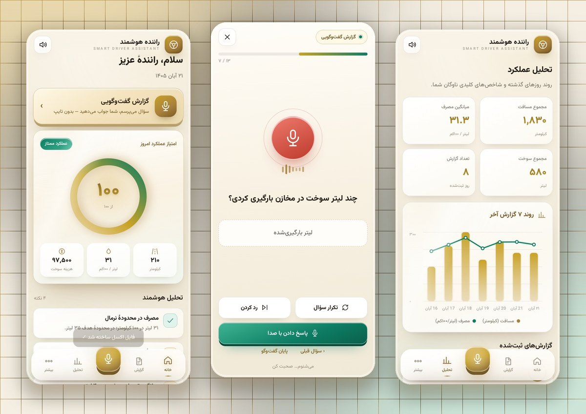
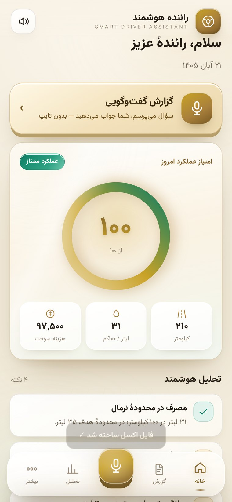
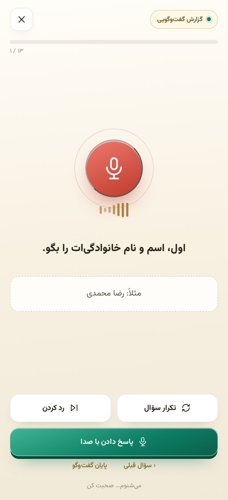
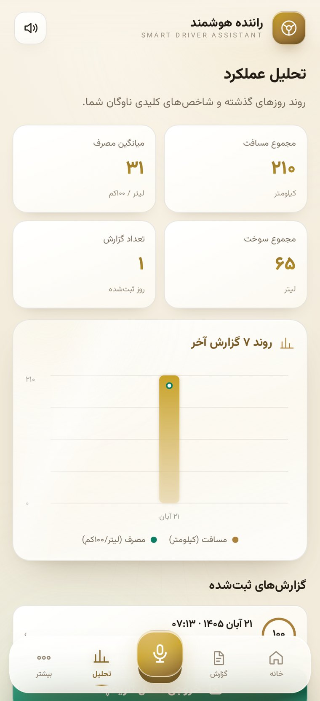

# راننده هوشمند — دستیار گزارش روزانهٔ رانندهٔ تانکر سوخت

<div align="center">

**اپلیکیشن فارسی، آفلاین و صوتی برای ثبت گزارش شیفت رانندگان تانکر و خودروهای سوخت‌رسان**

ساخته‌شده با HTML/CSS/JS خالص + پوستهٔ اندروید (Java/WebView) + اپ دسکتاپ (Electron) + ادغام Next.js

[امکانات](#امکانات) · [نصب](#نصب-و-اجرا) · [ساخت-از-منبع](#ساخت-از-منبع) · [معماری](#معماری) · [مجوز](#مجوز)

</div>

---

## چرا این پروژه؟

راننده در انتهای شیفت، خسته و دست‌به‌فرمان است؛ پر کردن فرم چندصفحه‌ای کار او نیست.
این اپ **سؤال‌ها را می‌پرسد** (با صدای فارسی)، **جواب‌ها را می‌شنود** (تشخیص گفتار زنده) و در پایان
یک **گزارش تمیز فارسی** + **فایل اکسل حرفه‌ای برای مدیر** می‌سازد. همه‌چیز **کاملاً آفلاین** روی گوشی انجام می‌شود؛
هیچ سرور، حساب کاربری، اینترنت یا پایگاه‌داده‌ای لازم نیست.

<div align="center">

</div>

## امکانات

| | |
|---|---|
| 🎙️ **مصاحبهٔ صوتی ۱۳ مرحله‌ای** | راننده فقط حرف می‌زند؛ دستیار سؤال بعدی را می‌پرسد و پاسخ را در فیلد درست می‌گذارد |
| 🔊 **خواندن سؤال‌ها با صدای فارسی** | موتور TTS سیستم اندروید (`fa-IR`) با fallback به Web Speech |
| 🧠 **درک زبان طبیعی فارسی** | اعداد گفتاری («هزار و پانصد»)، پلاک ایران، واژه‌های کلیدی هر فیلد |
| 📊 **محاسبهٔ خودکار** | مسافت، مصرف L/100km، درآمد، انحراف از هدف، روند شیفت |
| 📗 **خروجی اکسل حرفه‌ای** | سه برگه: `خلاصه شیفت` + `گزارش روز` + `تاریخچه` با جمع کل — تولید OOXML بدون هیچ کتابخانهٔ خارجی |
| 📤 **اشتراک‌گذاری برای مدیر** | ذخیره در `Downloads` و ارسال با `ACTION_SEND` به واتساپ/تلگرام/ایمیل |
| 🪶 **طراحی روشن و لوکس** | تم Ivory & Gold، کارت‌های سه‌بعدی با tilt، ساعت و نمودار SVG |
| 📴 **۱۰۰٪ آفلاین** | بدون CDN، بدون فونت آنلاین، بدون API؛ فونت وزیرمتن و همهٔ کدها درون بسته |
| 💾 **ذخیرهٔ محلی** | گزارش‌ها در `localStorage` (کلید `driver_assistant_v2`)، تا ۲۰۰ گزارش |
| 🖥️ **چهار هدف اجرا** | اندروید (APK) · ویندوز (Electron پرتابل) · نسخهٔ وب Next.js · یک فایل HTML مستقل |

<div align="center">
  
</div>

## نصب و اجرا

### اندروید (نسخهٔ کامل و توصیه‌شده)
فایل `SmartDriverAssistant-2.0.0.apk` را روی گوشی نصب کنید (Android 6+).
> APK در بخش **Releases** همین مخزن قرار می‌گیرد. راهنمای کامل: [`docs/INSTALL-android.md`](docs/INSTALL-android.md)

### ویندوز
- سبک (۸۱۰ کیلوبایت، بدون دسترسی مدیر): `SmartDriverAssistant-Windows-lite.zip` → اجرای `Install.bat`
- مستقل (Electron، ~۱۱۰ مگابایت): `SmartDriverAssistant.exe`
> راهنمای کامل: [`docs/INSTALL-windows.md`](docs/INSTALL-windows.md)

### نسخهٔ وب / Next.js
```bash
cd webapp
npm install
npm run dev        # http://localhost:3000
```
پایگاه‌داده اختیاری است؛ بدون `DATABASE_URL` همه‌چیز آفلاین روی مرورگر کار می‌کند.

### فایل تک‌نفره
`راننده-هوشمند-تک‌فایل.html` — همهٔ CSS/JS/فونت‌ها درون یک فایل؛ روی هر مرورگری آفلاین باز می‌شود.

## ساخت از منبع

### APK بدون Gradle
نیازمندی: JDK 17، Android SDK (build-tools 34، platform 34).
```bash
cd android
export JAVA_HOME=/path/to/jdk-17 ANDROID_HOME=/path/to/android-sdk
./build.sh
# خروجی: out/SmartDriverAssistant-2.0.0.apk
```
اسکریپت مرحله‌به‌مرحله: `aapt2 compile/link` → `javac --release 11` → `d8 --min-api 23` → `zipalign` → `apksigner`.

### نسخهٔ تک‌فایل
```bash
cd android && python3 make_preview.py     # همه‌چیز inline می‌شود
```

### اپ ویندوز
```bash
cd desktop
npm install
npx electron-builder --win --dir          # پرتابل → dist/win-unpacked
npx electron-builder --win nsis           # نصب‌کنندهٔ Setup.exe (نیازمند ویندوز یا wine)
```

## معماری

```
android/                 پوستهٔ اندروید + هستهٔ مشترک رابط کاربری
├─ app/src/…/MainActivity.java    پل بومی: SpeechRecognizer، TextToSpeech، MediaStore، ACTION_SEND
├─ app/AndroidManifest.xml        مجوزها، queries، تم
├─ web/                           ★ هستهٔ مشترک: index.html · app.js · style.css · xlsx.js · fonts
├─ build.sh                       ساخت APK بدون Gradle
└─ make_preview.py                ساخت فایل HTML تک‌نفره

webapp/                  ادغام Next.js 16 + Tailwind 4 (پوستهٔ HTML را در خود میزبانی می‌کند)
└─ src/app/page.tsx               تزریق shell + xlsx.js + app.js و فراخوانی window.__startDriverApp()

desktop/                 پوستهٔ Electron (همان web/ بدون تغییر منطق)
├─ main.js                        پنجرهٔ ۴۷۰×۹۰۰، منوی مخفی، بازکردن لینک خارجی، تأیید بستن
└─ app/                           دارایی‌های وب + آیکن

docs/                    راهنمای نصب، اسکرین‌شات‌ها
```

### پل بومی اندروید (JavaScript ↔ Java)
| تابع JS | کار |
|---|---|
| `startListening(continuous)` / `stopListening()` | شنیدن زندهٔ گفتار با نتایج میانی |
| `speak(text)` / `stopSpeaking()` | خواندن فارسی (`fa-IR`) و برگشت با `__onSpeakDone()` |
| `saveExcel(base64, name)` | نوشتن `.xlsx` در `Downloads` با MediaStore |
| `share(text)` / `whatsapp(text)` / `whatsappTo(phone, text)` | اشتراک‌گذاری گزارش |
| `toast(msg)` · `vibrate(ms)` · `platform()` | بازخورد و تشخیص پلتفرم |

### خروجی اکسل
تولید OOXML خالص در `web/xlsx.js` (بدون SheetJS/بدون شبکه): سه برگهٔ RTL با استایل، فرمول‌های جمع و نام فایل
`gozaresh-<نام>-<YYYY-MM-DD>.xlsx`.

## پشتهٔ فناوری
`HTML` `CSS` `JavaScript (ES5-safe)` `Java 11` `Android WebView` `Electron 38` `Next.js 16` `Tailwind 4` `Drizzle ORM (اختیاری)`

## مجوز
MIT — فایل [LICENSE](LICENSE) را ببینید.
